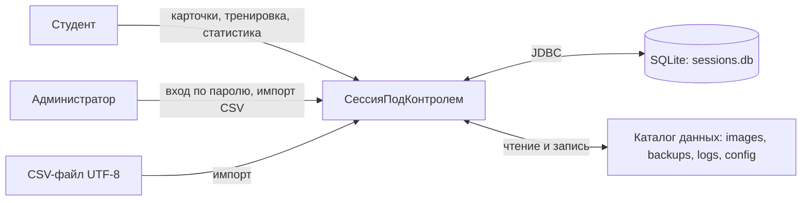
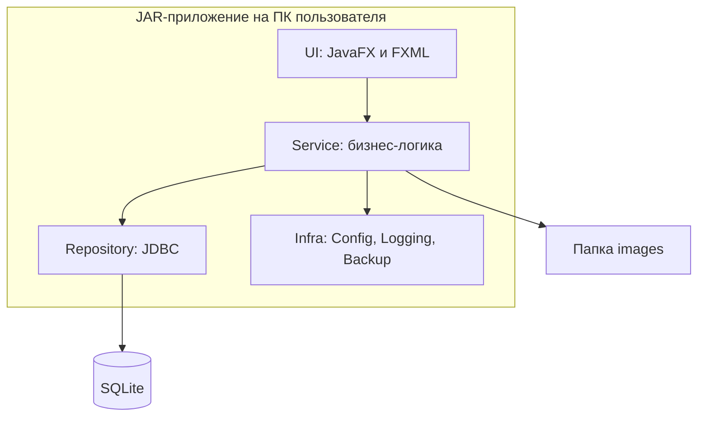
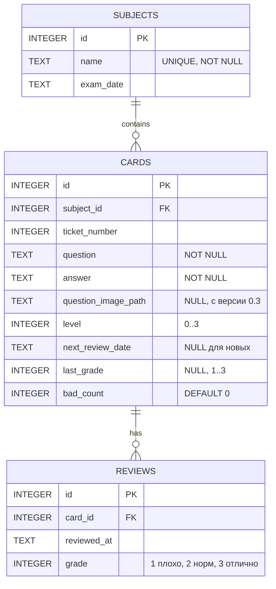
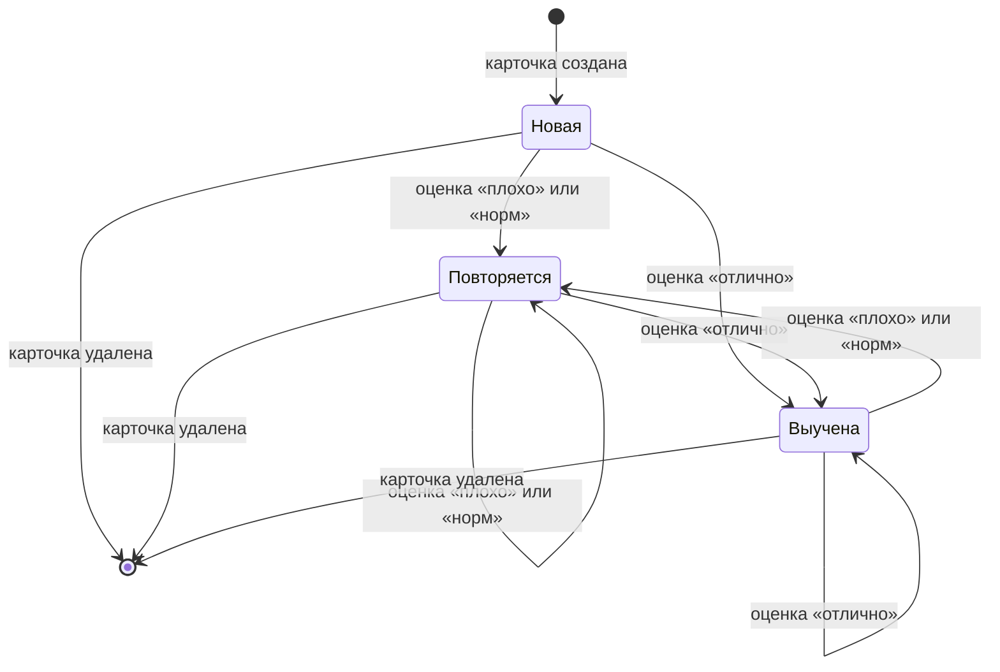
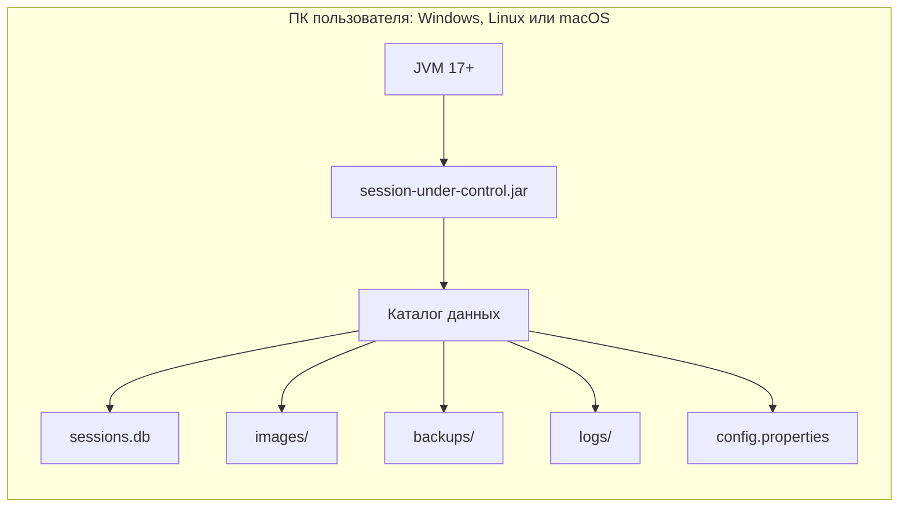

# Описание дизайна программного обеспечения

Для desktop-приложения "СессияПодКонтролем" — тренажёр для подготовки к сессии

Версия 0.3

Подготовил Григорчик Н.А.

БГУИР, ФКСиС, кафедра ЭВМ

19.11.2026

## Оглавление

<!-- TOC -->
* [1. Введение](#1-introduction)
  * [1.1 Назначение документа](#11-document-purpose)
  * [1.2 Область применения](#12-subject-scope)
  * [1.3 Определения, акронимы и сокращения](#13-definitions-acronyms-and-abbreviations)
  * [1.4 Ссылки](#14-references)
  * [1.5 Обзор документа](#15-document-overview)
* [2. Обзор дизайна](#2-design-overview)
  * [2.1 Задачи стейкхолдеров](#21-stakeholder-concerns)
  * [2.2 Выбранные точки зрения](#22-selected-viewpoints)
* [3. Проектные представления](#3-design-views)
* [4. Решения](#4-decisions)
* [5. Приложения](#5-appendixes)
<!-- TOC -->

## История изменений

| Name | Date | Reason For Changes | Version |
|------|------|--------------------|---------|
| Григорчик Н.А. | 17.11.2026 | Первоначальная версия: 8 точек зрения, ADR-0001 – ADR-0004 | 0.1 |
| Григорчик Н.А. | 18.11.2026 | По итогам раунда 1: упрощён импорт CSV (только UTF-8, откат при ошибке), фильтр статистики по периоду понижен до Could, функции «горячие клавиши, теги, подсказки» отложены (Deferred) | 0.2 |
| Григорчик Н.А. | 19.11.2026 | По итогам раунда 2: добавлены изображения к карточкам (поле `question_image_path`, `ImageService`, папка `images/`), резервная копия включает изображения, добавлен ADR-0005 | 0.3 |

---

## 1. Введение {#1-introduction}

### 1.1 Назначение документа {#11-document-purpose}

Настоящий SDD описывает архитектуру и дизайн desktop-приложения "СессияПодКонтролем" на основе согласованного документа SRS (версия 0.4). Документ отвечает на вопрос **КАК** система будет построена. Он предназначен для разработчиков (Senior и Junior), тестировщиков и Заказчика.

### 1.2 Область применения {#12-subject-scope}

Проектируемая система — автономное desktop-приложение (Java 17, JavaFX, SQLite, Maven) для подготовки к сессии: предметы с датами экзаменов, карточки «вопрос — ответ» (в том числе с изображением), режим тренировки с интервальным повторением, статистика прогресса и «западающих» карточек, напоминания при запуске, режим администратора с импортом CSV. Система не использует сеть и внешние сервисы. В текущую версию не входят: мобильная и web-версии, синхронизация, OCR, графики активности. Горячие клавиши, теги карточек и подсказки пустых экранов перенесены в релиз 2.0 (Deferred).

### 1.3 Определения, акронимы и сокращения {#13-definitions-acronyms-and-abbreviations}

| Term | Definition |
|------|------------|
| SDD | Software Design Description — описание дизайна ПО |
| ADR | Architectural Decision Record — запись архитектурного решения |
| FXML | XML-формат описания интерфейса JavaFX |
| JDBC | Java Database Connectivity — стандартный интерфейс доступа к БД |
| DAO / Repository | Класс, инкапсулирующий SQL-доступ к таблице |
| PBKDF2 | Алгоритм получения хэша пароля с солью и множеством итераций |
| Карточка к повторению | Карточка, у которой дата следующего показа наступила или которая ещё не показывалась |
| Западающая карточка | Карточка, получившая оценку «плохо» два и более раза |
| JAR | Исполняемый архив Java |

### 1.4 Ссылки {#14-references}

* Спецификация требований (SRS) версия 0.4 — `srs/srs-template.md` (Нормативная).
* Записи архитектурных решений ADR 0001–0005 — папка `adr/` (Нормативная).
* План реализации — `plan/plan.md` (Нормативная).
* IEEE 1016-2009 Systems and software engineering — Software design description (Справочная).
* ISO/IEC/IEEE 42010:2011 Architecture description (Справочная).

### 1.5 Обзор документа {#15-document-overview}

Раздел 2 описывает задачи стейкхолдеров и выбранные точки зрения. Раздел 3 содержит проектные представления с трассировкой на требования SRS. Раздел 4 фиксирует ключевые архитектурные решения. Раздел 5 содержит ссылки на смежные артефакты.

---

## 2. Обзор дизайна {#2-design-overview}

### 2.1 Задачи стейкхолдеров {#21-stakeholder-concerns}

* **Заказчик:** важно уложиться в срок и бюджет, получить работающий офлайн-тренажёр и не потерять свои карточки.
* **Разработчики (Senior и Junior):** нужно понимать слои приложения, схему БД и правило расчёта даты повторения; Junior должен брать независимые задачи (поиск, импорт, тесты).
* **QA-инженеры:** нужны чёткие состояния карточки и формулы для написания тест-кейсов.
* **Администратор:** нужен простой и безопасный способ загрузить базу вопросов из файла.
* **Студент:** нужны мгновенный отклик интерфейса и сохранность данных при закрытии приложения.

### 2.2 Выбранные точки зрения {#22-selected-viewpoints}

Выбраны 8 из 15 точек зрения (ISO/IEC/IEEE 42010). Остальные не адресуют задач стейкхолдеров: приложение однопользовательское, без сети и параллельной обработки.

#### 2.2.1 Контекст {#221-context}
**Адресует**: границы системы, акторы, внешние ресурсы.
**Применение в проекте**: Студент, Администратор, локальная файловая система; внешних сервисов нет.
**Выбранный язык моделирования**: контекстная диаграмма (C4 Context).

#### 2.2.2 Композиция {#222-composition}
**Адресует**: основные элементы дизайна и распределение ответственности.
**Применение в проекте**: монолитное приложение и его модули.
**Выбранный язык моделирования**: диаграмма компонентов.

#### 2.2.5 Структура {#225-structure}
**Адресует**: внутреннюю организацию кода.
**Применение в проекте**: слои UI, Service, Repository, Model и FXML-компоненты.
**Выбранный язык моделирования**: диаграмма пакетов.

#### 2.2.7 Информация {#227-information}
**Адресует**: структуру постоянных данных.
**Применение в проекте**: схема БД SQLite.
**Выбранный язык моделирования**: ER-диаграмма.

#### 2.2.8 Интерфейс {#228-interface}
**Адресует**: интерфейсы между экранами, компонентами и файловыми данными.
**Применение в проекте**: навигация между экранами, интерфейсы сервисов, формат CSV.
**Выбранный язык моделирования**: таблицы переходов и сигнатур.

#### 2.2.10 Алгоритм {#2210-algorithm}
**Адресует**: логику обработки данных.
**Применение в проекте**: расчёт даты следующего показа, отбор карточек, расчёт прогресса и «западающих» карточек.
**Выбранный язык моделирования**: псевдокод.

#### 2.2.11 Динамика состояний {#2211-state-dynamics}
**Адресует**: эволюцию состояния компонента в ответ на события.
**Применение в проекте**: жизненный цикл карточки.
**Выбранный язык моделирования**: диаграмма состояний UML.

#### 2.2.14 Развёртывание {#2214-deployment}
**Адресует**: отображение программных сущностей на физическое окружение.
**Применение в проекте**: JAR и каталог данных на ПК пользователя.
**Выбранный язык моделирования**: диаграмма развёртывания.

---

## 3. Проектные представления {#3-design-views}

### 001-context. Контекст системы

**ID:** 001-context  
**Title:** Контекст системы  
**Viewpoint:** Контекст  
**Representation:**



Акторы: Студент (основной пользователь, без пароля) и Администратор (по паролю). Внешних систем и сетевых соединений нет.  
**More Information:** Реализует `REQ-AUTH-001`, `REQ-AUTH-002`, `REQ-CON-003`, `REQ-SEC-001`, `REQ-REL-004`.

### 002-composition. Композиция и архитектура

**ID:** 002-composition  
**Title:** Композиция и архитектура  
**Viewpoint:** Композиция  
**Representation:**



Модули Service: `SubjectService`, `CardService`, `TrainingService` (с `IntervalPolicy`), `StatsService`, `ReminderService`, `AuthService`, `ImportService`, `ImageService` (с версии 0.3), `BackupService`. Монолит: приложение и БД работают на одном ПК.  
**More Information:** Реализует `REQ-CON-010`, `REQ-CON-011`, `REQ-SUBJ-001`…`REQ-SUBJ-008`, `REQ-CARD-001`…`REQ-CARD-010`, `REQ-TRAIN-001`…`REQ-TRAIN-009`, `REQ-STAT-001`…`REQ-STAT-005`, `REQ-NOTIF-001`…`REQ-NOTIF-003`.

### 003-structure. Слоевая структура приложения

**ID:** 003-structure  
**Title:** Слоевая структура приложения  
**Viewpoint:** Структура  
**Representation:** Пакеты: `by.bsuir.session.ui` (контроллеры и FXML), `by.bsuir.session.service`, `by.bsuir.session.repository`, `by.bsuir.session.model`, `by.bsuir.session.config`. Зависимости направлены вниз: UI → Service → Repository → Model. Контроллер не обращается к репозиторию напрямую; SQL существует только в слое Repository. Повторяющиеся элементы (шапка, подвал, прогресс-бар, кнопка оценки) вынесены в отдельные FXML-компоненты. Публичные методы сервисов документируются Javadoc.  
**More Information:** Реализует `REQ-CON-002`, `REQ-CON-011`, `REQ-CON-012`, `REQ-CON-013`, `REQ-SEC-003`.

### 004-information. Модель данных

**ID:** 004-information  
**Title:** Модель данных  
**Viewpoint:** Информация  
**Representation:**



Связи с каскадным удалением (`ON DELETE CASCADE`). Индекс `cards(subject_id, next_review_date)` ускоряет отбор карточек к повторению при 5000 карточек. Версия схемы хранится в `PRAGMA user_version`, миграции — SQL-скриптами. Пароль администратора в БД не хранится (см. ADR-0004).  
**More Information:** Реализует `REQ-SUBJ-001`…`REQ-SUBJ-003`, `REQ-SUBJ-008`, `REQ-CARD-001`…`REQ-CARD-008`, `REQ-TRAIN-008`, `REQ-STAT-001`, `REQ-STAT-002`, `REQ-PERF-003`, `REQ-REL-001`, `REQ-CON-001`.

### 005-interface. Интерфейсы экранов и сервисов

**ID:** 005-interface  
**Title:** Навигация, интерфейсы сервисов и формат CSV  
**Viewpoint:** Интерфейс  
**Representation:**

Переходы между экранами (соответствуют диаграммам SysML v2, SRS п. 5.1):

| Из экрана | В экран | Элемент перехода |
|-----------|---------|------------------|
| Мои предметы | Карточка вопроса | кнопка «Открыть» |
| Мои предметы | Режим тренировки | кнопка «Начать тренировку» |
| Мои предметы | Статистика прогресса | главное меню |
| Карточка вопроса | Мои предметы | навигационная цепочка |
| Карточка вопроса | Режим тренировки | кнопка «Тренировать предмет» |
| Режим тренировки | Мои предметы | кнопка выхода |
| Режим тренировки | Статистика прогресса | кнопка «Завершить» |
| Статистика прогресса | Режим тренировки | кнопка «Тренировать» |

Основные интерфейсы сервисов:

| Сервис | Методы |
|--------|--------|
| `SubjectService` | `create(name, examDate)`, `update(id, name, examDate)`, `delete(id)`, `search(text)`, `list(sort)` |
| `CardService` | `add(subjectId, ticket, question, answer)`, `update(...)`, `delete(id)`, `listBySubject(subjectId)` |
| `TrainingService` | `startSession(subjectId)` → список карточек к повторению; `rate(cardId, grade)` → дата следующего показа; `summary()` |
| `StatsService` | `overall()`, `bySubject(period)`, `weakCards(subjectId)` |
| `ReminderService` | `dueToday()`, `examWarnings(daysLeft)` |
| `AuthService` | `loginAdmin(password)` |
| `ImportService` | `importCsv(path)` → `ImportResult` или `ImportException(номер строки)` |
| `ImageService` | `attach(cardId, path)`, `remove(cardId)` (с версии 0.3) |
| `BackupService` | `backupOnStart()` |

Формат CSV для импорта (с версии 0.2): кодировка только UTF-8, разделитель `;`, первая строка — заголовок, столбцы `subject;exam_date;ticket;question;answer`, дата в формате `ДД.ММ.ГГГГ`. Импорт выполняется в одной транзакции: при ошибке в любой строке все изменения откатываются, пользователю показывается номер строки.

Ограничения изображений (с версии 0.3): форматы PNG и JPG, размер до 5 МБ, проверка через `ImageIO`.  
**More Information:** Реализует `REQ-UI-001`…`REQ-UI-007`, `REQ-AUTH-004`, `REQ-CARD-008`, `REQ-CARD-009`, `REQ-USAB-002`.

### 006-state-dynamics. Жизненный цикл карточки

**ID:** 006-state-dynamics  
**Title:** Жизненный цикл карточки  
**Viewpoint:** Динамика состояний  
**Representation:**



Признак «к повторению» вычисляется (дата следующего показа наступила или показов ещё не было). Признак «западающая» вычисляется по счётчику `bad_count ≥ 2`. Выход из тренировки не откатывает уже сохранённые оценки.  
**More Information:** Реализует `REQ-TRAIN-003`…`REQ-TRAIN-005`, `REQ-TRAIN-008`, `REQ-TRAIN-009`, `REQ-STAT-002`.

### 007-algorithm. Алгоритмы расчёта

**ID:** 007-algorithm  
**Title:** Алгоритмы интервального повторения и статистики  
**Viewpoint:** Алгоритм  
**Representation:**

```text
rate(card, grade, today):
    интервал = { ПЛОХО: 1, НОРМ: 3, ОТЛИЧНО: 7 }[grade]    // дней, ADR-0003
    card.next_review_date = today + интервал
    card.last_grade = grade; card.level = grade
    если grade == ПЛОХО: card.bad_count += 1
    в одной транзакции: UPDATE cards; INSERT INTO reviews

dueCards(subject, today):
    SELECT * FROM cards
    WHERE subject_id = ? AND (next_review_date IS NULL OR next_review_date <= today)
    ORDER BY next_review_date

progress(subject) = выученные / все * 100, где выученная: last_grade = ОТЛИЧНО
weakCards()       = карточки, где bad_count >= 2, по убыванию bad_count
averageScore      = AVG(grade) по таблице reviews предмета
```

Правило интервалов изолировано в классе `IntervalPolicy`, чтобы его можно было заменить без изменения остального кода.  
**More Information:** Реализует `REQ-TRAIN-004`, `REQ-TRAIN-005`, `REQ-SUBJ-007`, `REQ-STAT-001`…`REQ-STAT-004`.

### 008-deployment. Развёртывание системы

**ID:** 008-deployment  
**Title:** Развёртывание системы  
**Viewpoint:** Развёртывание  
**Representation:**



Сборка Maven (плагин сборки «толстого» JAR со всеми зависимостями). При каждом запуске `BackupService` копирует `sessions.db` и каталог `images/` в `backups/` с меткой времени и хранит последние 5 копий. Лог-файл не содержит текст ответов карточек.  
**More Information:** Реализует `REQ-CON-006`…`REQ-CON-010`, `REQ-CON-014`, `REQ-REL-003`, `REQ-REL-005`.

---

## 4. Решения {#4-decisions}

**ID:** ADR-0001  
**Title:** JavaFX с FXML для пользовательского интерфейса  
**Context:** Нужно построить desktop-интерфейс на заданном SRS стеке с повторно используемыми компонентами.  
**Options:** JavaFX + FXML; JavaFX без FXML (интерфейс в коде); Swing.  
**Outcome:** Выбран JavaFX + FXML. Обоснование: разделение разметки и логики, компоненты шапки и подвала.  
**More Information:** Влияет на `002-composition` и `003-structure`. Файл `adr/0001-use-javafx-fxml.md`.

**ID:** ADR-0002  
**Title:** SQLite и чистый JDBC  
**Context:** Нужно локальное хранилище без сервера и без ORM-инфраструктуры, безопасное к SQL-инъекциям.  
**Options:** SQLite + JDBC; SQLite + Hibernate/JPA; H2.  
**Outcome:** Выбран SQLite + JDBC с классами Repository и `PreparedStatement`.  
**More Information:** Влияет на `004-information`. Файл `adr/0002-use-sqlite-jdbc.md`.

**ID:** ADR-0003  
**Title:** Фиксированные интервалы повторения 1/3/7 дней  
**Context:** Нужно простое и предсказуемое правило, понятное Заказчику и тестируемое.  
**Options:** фиксированные интервалы; алгоритм SM-2; коробки Лейтнера.  
**Outcome:** Выбраны фиксированные интервалы в классе `IntervalPolicy`.  
**More Information:** Влияет на `007-algorithm`. Файл `adr/0003-fixed-review-intervals.md`.

**ID:** ADR-0004  
**Title:** Хранение пароля администратора  
**Context:** Пароль нельзя хранить открытым текстом (`REQ-AUTH-003`).  
**Options:** PBKDF2 из JDK с солью; BCrypt (внешняя библиотека); открытый текст.  
**Outcome:** Выбран PBKDF2WithHmacSHA256 из JDK; соль и хэш хранятся в `config.properties`.  
**More Information:** Влияет на `005-interface` и `008-deployment`. Файл `adr/0004-admin-password-hash.md`.

**ID:** ADR-0005  
**Title:** Хранение изображений карточек  
**Context:** В ходе раунда 2 Заказчик запросил изображения к карточкам (`REQ-CARD-008`).  
**Options:** файлы в каталоге `images/` + путь в БД; BLOB в SQLite; Base64-текст в БД.  
**Outcome:** Выбраны файлы в каталоге `images/`, в БД хранится относительный путь.  
**More Information:** Влияет на `004-information`, `005-interface`, `008-deployment`. Файл `adr/0005-card-image-storage.md`.

---

## 5. Приложения {#5-appendixes}

* Спецификация требований (SRS): `srs/srs-template.md`
* Структурные диаграммы интерфейса (SysML v2): `srs/images/`
* ADR: `adr/`
* План реализации: `plan/plan.md`
* Переписка с Заказчиком: `docs/correspondence.md`
