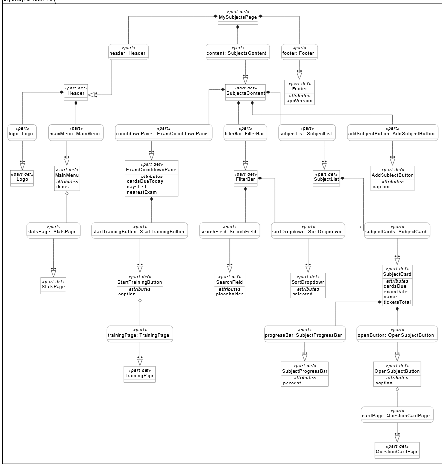
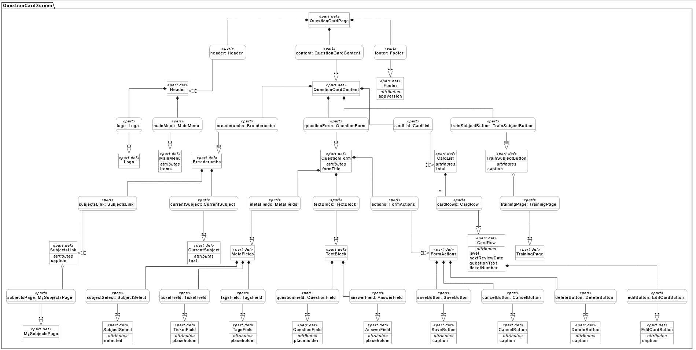
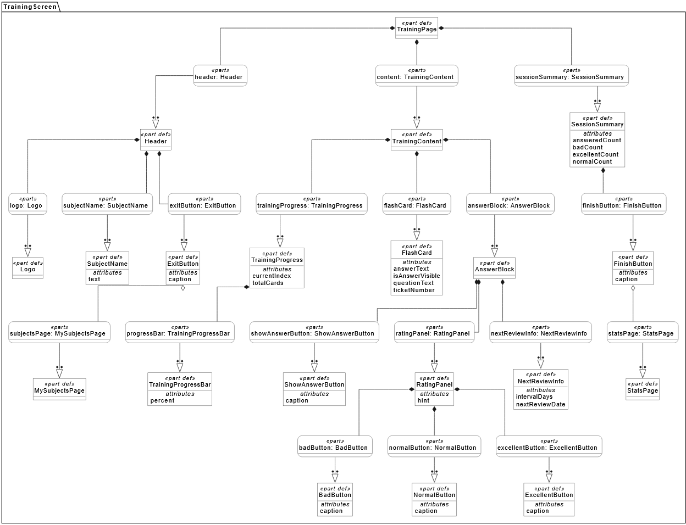
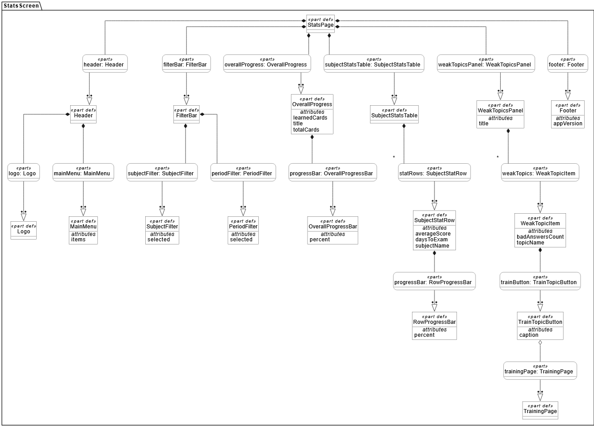

# Спецификация требований к ПО

Для desktop-приложения "СессияПодКонтролем" — тренажёр для подготовки к сессии

Версия 0.2

Подготовил Григорчик Н.А.

БГУИР, ФКСиС, кафедра ЭВМ

05.11.2026

## Оглавление

<!-- TOC -->
* [1. Введение](#1-introduction)
  * [1.1 Назначение документа](#11-document-purpose)
  * [1.2 Область применения продукта](#12-product-scope)
  * [1.3 Определения, акронимы и сокращения](#13-definitions-acronyms-and-abbreviations)
  * [1.4 Ссылки](#14-references)
  * [1.5 Обзор документа](#15-document-overview)
* [2. Обзор продукта](#2-product-overview)
  * [2.1 Перспектива продукта](#21-product-perspective)
  * [2.2 Функции продукта](#22-product-functions)
  * [2.3 Ограничения продукта](#23-product-constraints)
  * [2.4 Характеристики пользователей](#24-user-characteristics)
  * [2.5 Допущения и зависимости](#25-assumptions-and-dependencies)
  * [2.6 Распределение требований](#26-apportioning-of-requirements)
* [3. Требования](#3-requirements)
  * [3.1 Внешние интерфейсы](#31-external-interfaces)
    * [3.1.1 Пользовательские интерфейсы](#311-user-interfaces)
    * [3.1.2 Аппаратные интерфейсы](#312-hardware-interfaces)
    * [3.1.3 Программные интерфейсы](#313-software-interfaces)
  * [3.2 Функциональные требования](#32-functional)
  * [3.3 Качество обслуживания](#33-quality-of-service)
    * [3.3.1 Производительность](#331-performance)
    * [3.3.2 Безопасность](#332-security)
    * [3.3.3 Надёжность](#333-reliability)
    * [3.3.4 Доступность](#334-availability)
    * [3.3.5 Наблюдаемость](#335-observability)
  * [3.4 Соответствие стандартам](#34-compliance)
  * [3.5 Проектирование и реализация](#35-design-and-implementation)
    * [3.5.1 Установка](#351-installation)
    * [3.5.2 Сборка и поставка](#352-build-and-delivery)
    * [3.5.3 Распределение](#353-distribution)
    * [3.5.4 Сопровождаемость](#354-maintainability)
    * [3.5.5 Повторное использование](#355-reusability)
    * [3.5.6 Переносимость](#356-portability)
    * [3.5.7 Стоимость](#357-cost)
    * [3.5.8 Сроки](#358-deadline)
    * [3.5.9 Доказательство концепции](#359-proof-of-concept)
    * [3.5.10 Управление изменениями](#3510-change-management)
  * [3.6 ИИ/МО](#36-aiml)
* [4. Верификация](#4-verification)
* [5. Приложения](#5-appendixes)
<!-- TOC -->

## История изменений

| Name | Date | Reason For Changes | Version |
|------|------|--------------------|---------|
| Григорчик Н.А. | 05.11.2026 | Создание первоначальной версии документа | 0.1 |
| Григорчик Н.А. | 05.11.2026 | Добавлены структурные диаграммы интерфейса (SysML v2) | 0.2 |

---

## 1. Введение {#1-introduction}

### 1.1 Назначение документа {#11-document-purpose}

Настоящий документ (SRS) определяет бизнес-требования, функциональные и нефункциональные требования к desktop-приложению "СессияПодКонтролем". Документ предназначен для заказчика, менеджеров проекта, разработчиков и тестировщиков. Он описывает **ЧТО** должна делать система, и служит основой для проектирования, реализации и верификации продукта.

### 1.2 Область применения продукта {#12-product-scope}

**Что входит в проект (in scope):**
- desktop-приложение для ведения карточек с вопросами по предметам и подготовки к сессии;
- создание предметов с датой экзамена и карточек (билет, вопрос, ответ) внутри предмета;
- режим тренировки: показ вопроса, скрытие ответа, самооценка («плохо», «норм», «отлично»);
- интервальное повторение: дата следующего показа карточки рассчитывается автоматически по самооценке;
- статистика прогресса по каждому предмету и выявление «западающих» карточек;
- напоминания о карточках, которые пора повторить, и о приближающихся экзаменах;
- локальное хранение всех данных в базе SQLite (работа без интернета);
- режим администратора для загрузки предзаполненной базы вопросов из CSV-файла.

**Что не входит в проект (out of scope):**
- мобильные приложения для iOS и Android и веб-версия;
- многопользовательский режим и синхронизация между устройствами;
- интеграция с внешними образовательными платформами и любыми внешними API;
- автоматическое распознавание текста с фотографий (OCR) для добавления вопросов;
- облачное хранение данных и резервное копирование в облако;
- графики и диаграммы активности (в первой версии показываются только числа и прогресс-бары).

### 1.3 Определения, акронимы и сокращения {#13-definitions-acronyms-and-abbreviations}

| Term | Definition |
|------|------------|
| SRS | Software Requirements Specification — документ, описывающий назначение, требования и характер ПО |
| UI | User Interface — визуальная часть приложения, через которую пользователь взаимодействует с ПО |
| SysML v2 | Systems Modeling Language — язык для структурного моделирования интерфейсов |
| JavaFX | Библиотека для создания графического интерфейса desktop-приложений на Java |
| SQLite | Встраиваемая реляционная СУБД, хранящая данные в одном файле |
| БД | База данных |
| Предмет | Учебная дисциплина с датой экзамена, к которой относится набор карточек |
| Карточка | Вопрос (билет) с ответом, отображаемый в режиме тренировки |
| Интервальное повторение | Методика, при которой дата следующего показа карточки зависит от самооценки ответа |
| Самооценка | Оценка пользователем своего ответа: «плохо», «норм», «отлично» |
| Выученная карточка | Карточка, последняя самооценка которой — «отлично» |
| Западающая карточка | Карточка, получившая оценку «плохо» два и более раза |
| Карточка к повторению | Карточка, дата следующего показа которой наступила (или ещё ни разу не показывалась) |
| Прогресс предмета | Доля выученных карточек предмета от общего числа его карточек, в процентах |
| Приоритет требования | Must — обязательное; Should — желательное; Could — реализуется при наличии времени |

### 1.4 Ссылки {#14-references}

- СТП БГУИР (оформление документов).
- IEEE 830 / ISO/IEC/IEEE 29148 (стандарты написания SRS).
- Шаблон `srs-template.md` из репозитория кафедры ЭВМ БГУИР.
- Структурные диаграммы интерфейса SysML v2 (раздел 5.1).

### 1.5 Обзор документа {#15-document-overview}

Раздел 1 содержит введение и глоссарий. Раздел 2 описывает обзор продукта, бизнес-цели и ограничения. Раздел 3 содержит детальные требования с уникальными идентификаторами. Раздел 4 содержит матрицу верификации требований. Раздел 5 содержит ссылки на приложения и журнал замечаний.

Каждое требование имеет идентификатор вида `REQ-[AREA]-[NNN]`, где `AREA` — категория, а `NNN` — порядковый номер внутри категории. В скобках после идентификатора указан приоритет (Must / Should / Could).

| AREA | Категория |
|------|-----------|
| AUTH | Роли и доступ |
| SUBJ | Управление предметами |
| CARD | Управление карточками |
| TRAIN | Режим тренировки и интервальное повторение |
| STAT | Статистика прогресса |
| NOTIF | Напоминания |
| UI | Пользовательский интерфейс |
| PERF | Производительность |
| SEC | Безопасность |
| USAB | Удобство использования |
| REL | Надёжность, доступность, наблюдаемость |
| CON | Ограничения, стандарты, проектирование и реализация |

---

## 2. Обзор продукта {#2-product-overview}

### 2.1 Перспектива продукта {#21-product-perspective}

"СессияПодКонтролем" — новый самостоятельный продукт. Ранее студенты готовились к экзаменам, используя бумажные билеты, списки вопросов в Word или заметки в телефоне, и часто откладывали подготовку на последнюю ночь, забывая повторять пройденный материал. Приложение должно сделать подготовку структурированной и снизить долю «зубрёжки в последнюю ночь».

**Бизнес-цели:**
1. Помочь студенту распределять подготовку к сессии, а не зубрить всё в последнюю ночь.
2. Показать, какие темы «западают», чтобы фокусироваться на них.
3. Не забывать выученное за счёт интервального повторения.
4. Дать наглядное представление о прогрессе по каждому предмету.

**Внешние системы:**
- приложение не использует внешние системы и работает полностью офлайн.

### 2.2 Функции продукта {#22-product-functions}

- Управление личным списком предметов с датами экзаменов (CRUD-операции).
- Управление карточками вопросов внутри предмета (CRUD-операции).
- Режим тренировки с показом вопроса, скрытием ответа и самооценкой.
- Автоматический расчёт даты следующего повторения (интервальное повторение).
- Статистика прогресса по предметам и список «западающих» карточек.
- Напоминания о необходимости тренировки и о приближающихся экзаменах.
- Загрузка предзаполненной базы вопросов администратором.

### 2.3 Ограничения продукта {#23-product-constraints}

- Только Desktop-версия.
- Русский язык интерфейса.
- Строгий технологический стек: Java 17, JavaFX, SQLite, Maven.
- Отсутствие подключения к интернету (работа офлайн).
- Соответствие СТП БГУИР при оформлении документации.

### 2.4 Характеристики пользователей {#24-user-characteristics}

- **Студент (основной пользователь):** готовится к сессии. Создаёт предметы и карточки, проходит тренировки, просматривает статистику. Работает в приложении без ввода пароля.
- **Администратор:** разработчик или преподаватель. Входит в режим администратора по паролю и загружает в приложение предзаполненную базу вопросов.

### 2.5 Допущения и зависимости {#25-assumptions-and-dependencies}

- Пользователь работает на ПК с установленной Java 17 или новее.
- Пользователь самостоятельно создаёт предметы и карточки либо использует предзаполненную базу.
- Напоминания работают только при запущенном приложении.
- Пользователь самостоятельно оценивает свои ответы честно (приложение не проверяет правильность ответов).

### 2.6 Распределение требований {#26-apportioning-of-requirements}

| Компонент | Требования |
|-----------|-----------|
| Роли и доступ | REQ-AUTH-001 – REQ-AUTH-004 |
| Управление предметами | REQ-SUBJ-001 – REQ-SUBJ-008 |
| Управление карточками | REQ-CARD-001 – REQ-CARD-007 |
| Тренировка | REQ-TRAIN-001 – REQ-TRAIN-009 |
| Статистика | REQ-STAT-001 – REQ-STAT-005 |
| Напоминания | REQ-NOTIF-001 – REQ-NOTIF-003 |
| Интерфейс | REQ-UI-001 – REQ-UI-007 |
| Удобство использования | REQ-USAB-001 – REQ-USAB-004 |
| Производительность | REQ-PERF-001 – REQ-PERF-003 |
| Безопасность | REQ-SEC-001 – REQ-SEC-003 |
| Надёжность, доступность, наблюдаемость | REQ-REL-001 – REQ-REL-005 |
| Ограничения и реализация | REQ-CON-001 – REQ-CON-019 |

---

## 3. Требования {#3-requirements}

### 3.1 Внешние интерфейсы {#31-external-interfaces}

#### 3.1.1 Пользовательские интерфейсы {#311-user-interfaces}

- **REQ-UI-001:** (Must) Система должна предоставлять главный экран «Мои предметы», содержащий: панель «До экзамена» (ближайший экзамен, число дней до него, число карточек к повторению сегодня, кнопка «Начать тренировку»), панель фильтров (поле поиска и выбор сортировки), список карточек предметов (название, дата экзамена, число билетов, число карточек к повторению, прогресс-бар, кнопка «Открыть»), кнопку «Добавить предмет» и подвал.
- **REQ-UI-002:** (Must) Система должна предоставлять экран «Карточка вопроса», содержащий: навигационную цепочку, форму карточки (предмет, номер билета, вопрос, ответ, теги; кнопки «Сохранить», «Отмена», «Удалить»), список карточек предмета (номер билета, текст вопроса, уровень, дата следующего повторения, кнопка редактирования) и кнопку «Тренировать предмет».
- **REQ-UI-003:** (Must) Система должна предоставлять экран «Режим тренировки», содержащий: название предмета и кнопку выхода, индикатор хода тренировки («n из m» и прогресс-бар), карточку с вопросом и ответом, кнопку «Показать ответ», панель самооценки («плохо», «норм», «отлично»), информацию о дате следующего повторения и итог сессии с кнопкой «Завершить».
- **REQ-UI-004:** (Must) Система должна предоставлять экран «Статистика прогресса», содержащий: фильтры по предмету и периоду, блок общего прогресса (выучено и всего карточек, прогресс-бар), таблицу по предметам (название, дней до экзамена, средняя оценка, прогресс-бар) и панель «западающих» тем с кнопкой «Тренировать».
- **REQ-UI-005:** (Should) На всех экранах должны отображаться шапка с логотипом и главным меню и подвал с версией приложения.
- **REQ-UI-006:** (Must) Переходы между экранами должны соответствовать структурным диаграммам SysML v2 (раздел 5.1): «Мои предметы» → «Карточка вопроса», «Режим тренировки», «Статистика прогресса»; «Карточка вопроса» → «Мои предметы», «Режим тренировки»; «Режим тренировки» → «Мои предметы», «Статистика прогресса»; «Статистика прогресса» → «Режим тренировки». Переход на любой экран из главного меню шапки не должен зависеть от текущего экрана.

#### 3.1.2 Аппаратные интерфейсы {#312-hardware-interfaces}

- **REQ-UI-007:** (Must) Система должна поддерживать ввод данных с клавиатуры и мыши.

#### 3.1.3 Программные интерфейсы {#313-software-interfaces}

- **REQ-CON-001:** (Must) Система должна использовать SQLite (через JDBC) для локального хранения данных.
- **REQ-CON-002:** (Must) Система должна использовать JavaFX для отрисовки пользовательского интерфейса.
- **REQ-CON-003:** (Must) Система не должна требовать подключения к внешним API и сервисам.

### 3.2 Функциональные требования {#32-functional}

**Роли и доступ**

- **REQ-AUTH-001:** (Must) Система должна запускаться в режиме «Студент» без ввода пароля.
- **REQ-AUTH-002:** (Should) Режим «Администратор» должен быть доступен только после ввода пароля.
- **REQ-AUTH-003:** (Should) Пароль администратора должен храниться в конфигурации в виде хэша, а не в открытом виде.
- **REQ-AUTH-004:** (Could) В режиме «Администратор» система должна позволять загрузить предзаполненную базу вопросов (предметы и карточки) из CSV-файла.

**Предметы**

- **REQ-SUBJ-001:** (Must) Система должна позволять пользователю создавать новый предмет с указанием названия и даты экзамена.
- **REQ-SUBJ-002:** (Must) Система должна позволять редактировать название и дату экзамена существующего предмета.
- **REQ-SUBJ-003:** (Must) Система должна позволять удалять предмет вместе со всеми его карточками после подтверждения.
- **REQ-SUBJ-004:** (Should) Система должна показывать число дней до ближайшего экзамена на главном экране.
- **REQ-SUBJ-005:** (Should) Система должна позволять искать предметы по части названия.
- **REQ-SUBJ-006:** (Could) Система должна позволять сортировать список предметов по названию, дате экзамена и прогрессу.
- **REQ-SUBJ-007:** (Should) Для каждого предмета система должна показывать прогресс-бар, отражающий долю выученных карточек.
- **REQ-SUBJ-008:** (Must) Система не должна позволять создать предмет с пустым названием или с названием, совпадающим с уже существующим.

**Карточки**

- **REQ-CARD-001:** (Must) Система должна позволять добавлять карточку в предмет с указанием вопроса и ответа.
- **REQ-CARD-002:** (Must) Система должна позволять редактировать текст вопроса и ответа карточки.
- **REQ-CARD-003:** (Must) Система должна позволять удалять карточку из предмета после подтверждения.
- **REQ-CARD-004:** (Should) Система должна позволять указывать номер билета для карточки.
- **REQ-CARD-005:** (Could) Система должна позволять указывать теги для карточки.
- **REQ-CARD-006:** (Must) Система не должна позволять сохранить карточку с пустым вопросом или пустым ответом.
- **REQ-CARD-007:** (Must) Система должна показывать список карточек выбранного предмета с номером билета, текстом вопроса, уровнем и датой следующего повторения.

**Тренировка**

- **REQ-TRAIN-001:** (Must) Система должна позволять пользователю запускать режим тренировки по выбранному предмету.
- **REQ-TRAIN-002:** (Must) В режиме тренировки система должна показывать вопрос карточки и скрывать ответ до нажатия пользователем кнопки «Показать ответ».
- **REQ-TRAIN-003:** (Must) После показа ответа система должна предлагать пользователю оценить свой ответ по шкале «плохо», «норм», «отлично».
- **REQ-TRAIN-004:** (Must) Система должна рассчитывать дату следующего показа карточки: «плохо» — на следующий день, «норм» — через 3 дня, «отлично» — через 7 дней.
- **REQ-TRAIN-005:** (Must) В тренировку должны включаться только карточки к повторению: новые и те, у которых дата следующего показа наступила.
- **REQ-TRAIN-006:** (Should) Система должна показывать ход тренировки в виде «n из m» и прогресс-бара.
- **REQ-TRAIN-007:** (Should) По окончании тренировки система должна показывать итог: число отвеченных карточек и количество оценок «плохо», «норм» и «отлично».
- **REQ-TRAIN-008:** (Must) Система должна сохранять самооценку и новую дату повторения сразу после оценки каждой карточки.
- **REQ-TRAIN-009:** (Should) Система должна позволять выйти из тренировки в любой момент без потери уже сохранённых оценок.

**Статистика**

- **REQ-STAT-001:** (Must) Система должна отображать количество выученных и оставшихся карточек по каждому предмету.
- **REQ-STAT-002:** (Must) Система должна отображать список «западающих» карточек, отсортированный по числу оценок «плохо».
- **REQ-STAT-003:** (Should) Система должна позволять фильтровать статистику по предмету и по периоду (7 дней, 30 дней, всё время).
- **REQ-STAT-004:** (Should) Система должна отображать для каждого предмета число дней до экзамена, среднюю оценку и прогресс.
- **REQ-STAT-005:** (Could) Система должна позволять запустить тренировку только по «западающим» карточкам выбранной темы.

**Напоминания**

- **REQ-NOTIF-001:** (Must) Система должна отображать напоминание при запуске, если есть карточки к повторению.
- **REQ-NOTIF-002:** (Should) Система должна показывать на главном экране число карточек к повторению сегодня.
- **REQ-NOTIF-003:** (Could) Система должна предупреждать о приближении экзамена, если до него осталось 3 дня или меньше.

### 3.3 Качество обслуживания {#33-quality-of-service}

#### 3.3.1 Производительность {#331-performance}

- **REQ-PERF-001:** (Must) Время запуска приложения не должно превышать 5 секунд на ПК с 2 ГБ ОЗУ.
- **REQ-PERF-002:** (Must) Время отклика на действия пользователя (переключение экранов, сохранение карточки, оценка ответа) не должно превышать 1 секунды.
- **REQ-PERF-003:** (Should) Приложение должно работать без деградации при наличии до 5000 карточек в базе: открытие списка карточек предмета не должно занимать более 2 секунд.

#### 3.3.2 Безопасность {#332-security}

- **REQ-SEC-001:** (Must) Приложение не должно передавать пользовательские данные по сети.
- **REQ-SEC-002:** (Must) Приложение должно хранить данные локально в файле базы данных SQLite.
- **REQ-SEC-003:** (Must) Все запросы к базе данных должны выполняться с параметрами (PreparedStatement), без подстановки пользовательского ввода в текст SQL.

#### 3.3.3 Надёжность {#333-reliability}

- **REQ-REL-001:** (Must) При некорректном завершении работы приложение не должно терять ранее сохранённые данные (использование транзакций БД).
- **REQ-REL-002:** (Must) Приложение должно корректно обрабатывать ошибки чтения и записи базы данных и выводить понятное сообщение пользователю.
- **REQ-REL-003:** (Should) При запуске приложение должно создавать резервную копию файла базы данных.

#### 3.3.4 Доступность {#334-availability}

- **REQ-REL-004:** (Must) Приложение должно быть полностью работоспособно после установки без подключения к интернету.

#### 3.3.5 Наблюдаемость {#335-observability}

- **REQ-REL-005:** (Should) Приложение должно вести локальный лог-файл с информацией об ошибках и ключевых действиях пользователя. Лог не должен содержать текст ответов на карточки.

**Удобство использования**

- **REQ-USAB-001:** (Must) Интерфейс должен корректно отображаться в окнах размером от 1024×768.
- **REQ-USAB-002:** (Must) Необратимые действия (удаление предмета или карточки) должны требовать подтверждения.
- **REQ-USAB-003:** (Could) В режиме тренировки должны работать горячие клавиши: «Пробел» — показать ответ, «1», «2», «3» — оценки «плохо», «норм», «отлично».
- **REQ-USAB-004:** (Should) При отсутствии предметов или карточек система должна показывать подсказку о том, как их добавить.

### 3.4 Соответствие стандартам {#34-compliance}

- **REQ-CON-004:** (Must) Структура требований должна соответствовать ISO/IEC/IEEE 29148:2018.
- **REQ-CON-005:** (Must) Документация должна быть оформлена в соответствии с СТП БГУИР.

### 3.5 Проектирование и реализация {#35-design-and-implementation}

#### 3.5.1 Установка {#351-installation}

- **REQ-CON-006:** (Must) Система должна распространяться в виде исполняемого `.jar`-файла.
- **REQ-CON-007:** (Must) Для запуска приложения на ПК должна быть установлена Java 17 или новее.

#### 3.5.2 Сборка и поставка {#352-build-and-delivery}

- **REQ-CON-008:** (Must) Сборка проекта должна осуществляться с помощью системы сборки Maven.
- **REQ-CON-009:** (Must) Результатом сборки должен быть исполняемый JAR-файл со всеми зависимостями.

#### 3.5.3 Распределение {#353-distribution}

- **REQ-CON-010:** (Must) Приложение и локальная БД SQLite разворачиваются на одном ПК (монолитная архитектура).

#### 3.5.4 Сопровождаемость {#354-maintainability}

- **REQ-CON-011:** (Should) Код должен быть структурирован по слоям: UI, Service, Repository, Model.
- **REQ-CON-012:** (Should) Публичные методы сервисного слоя должны быть задокументированы с помощью Javadoc.

#### 3.5.5 Повторное использование {#355-reusability}

- **REQ-CON-013:** (Should) Повторяющиеся элементы UI (шапка, подвал, кнопки, прогресс-бары) должны быть реализованы в виде отдельных FXML-компонентов.

#### 3.5.6 Переносимость {#356-portability}

- **REQ-CON-014:** (Must) Приложение должно запускаться на Windows, Linux и macOS при наличии установленной JVM.

#### 3.5.7 Стоимость {#357-cost}

- **REQ-CON-015:** (Must) Все используемые библиотеки должны иметь открытый исходный код (Open Source). Стоимость разработки — 0 BYN (в рамках учебного проекта).

#### 3.5.8 Сроки {#358-deadline}

- **REQ-CON-016:** (Must) MVP (минимально жизнеспособный продукт) должен быть готов в течение текущего семестра.

#### 3.5.9 Доказательство концепции {#359-proof-of-concept}

- **REQ-CON-017:** (Should) Прототип интерфейса должен быть разработан в виде структурных диаграмм SysML v2 до начала основной разработки.

#### 3.5.10 Управление изменениями {#3510-change-management}

- **REQ-CON-018:** (Must) Все изменения требований должны фиксироваться в истории изменений SRS.
- **REQ-CON-019:** (Must) Изменения должны вноситься через Pull Request в ветку `main`.

### 3.6 ИИ/МО {#36-aiml}

Раздел не применим. В текущей версии продукта "СессияПодКонтролем" не используются технологии машинного обучения или искусственного интеллекта. Интервальное повторение реализуется простым правилом из REQ-TRAIN-004.

---

## 4. Верификация {#4-verification}

| Requirement ID | Verification Method | Test/Artifact Link | Status | Evidence |
|----------------|---------------------|--------------------|--------|----------|
| REQ-AUTH-002 | Test | tests/admin-access.md | WIP | |
| REQ-SUBJ-001 | Test | tests/create-subject.md | WIP | |
| REQ-SUBJ-003 | Test | tests/delete-subject.md | WIP | |
| REQ-CARD-001 | Test | tests/create-card.md | WIP | |
| REQ-CARD-006 | Test | tests/card-validation.md | WIP | |
| REQ-TRAIN-002 | Demonstration | tests/start-training.md | WIP | |
| REQ-TRAIN-004 | Test | tests/spaced-repetition.md | WIP | |
| REQ-TRAIN-005 | Test | tests/due-cards.md | WIP | |
| REQ-STAT-001 | Demonstration | tests/statistics.md | WIP | |
| REQ-STAT-002 | Test | tests/weak-cards.md | WIP | |
| REQ-NOTIF-001 | Demonstration | tests/startup-reminder.md | WIP | |
| REQ-UI-006 | Inspection | srs/sysml/ | WIP | |
| REQ-PERF-001 | Test | tests/performance.md | WIP | |
| REQ-SEC-001 | Inspection | — | WIP | |
| REQ-SEC-003 | Inspection | — | WIP | |
| REQ-REL-001 | Test | tests/transaction-safety.md | WIP | |
| REQ-REL-004 | Demonstration | tests/offline.md | WIP | |
| REQ-USAB-002 | Test | tests/confirm-delete.md | WIP | |
| REQ-CON-004 | Analysis | — | WIP | |

---

## 5. Приложения {#5-appendixes}

### 5.1 Диаграммы интерфейса

**Структура экрана «Мои предметы»:**

**Структура экрана «Карточка вопроса»:**

**Структура экрана «Режим тренировки»:**

**Структура экрана «Статистика прогресса»:**

### 5.2 Ссылки на артефакты

- Репозиторий: https://github.com/mikitka-blr/SDLC
- Структурные диаграммы SysML v2 (PNG): srs/images/
- Исходный код диаграмм SysML v2: srs/sysml/
